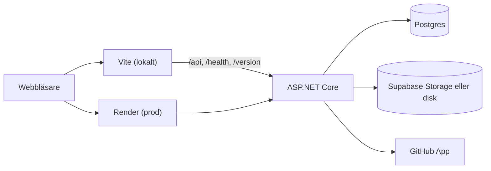

# Arkitektur

En backend och en klient i samma repo. I prod är de en Docker-image: backend serverar API:et och den byggda klienten från `wwwroot`. Lokalt kör klienten i Vite, som skickar API-anropen vidare till backend.

## Backend

Ett projekt, `backend/`, uppdelat i fyra lager. Beroenden går bara inåt: `Api` → `Application` → `Domain`, och `Infrastructure` implementerar gränssnitten i `Application`.

| Mapp              | Innehåll                                                                                                                                                                  |
| ----------------- | ------------------------------------------------------------------------------------------------------------------------------------------------------------------------- |
| `Domain/`         | Entiteter och enums. Inga beroenden.                                                                                                                                      |
| `Application/`    | Tjänster med affärsreglerna, DTO:er, gränssnitt (`Abstractions/`) och `ServiceResult`.                                                                                    |
| `Infrastructure/` | EF Core (`Persistence/`), inloggning (`Auth/`), fillagring (`Storage/`), notisjobbet (`Notifications/`), GitHub-appen och dess jobb (`GitHub/`) och elevrepona (`Labs/`). |
| `Api/`            | Minimal API-endpoints (`Endpoints/`), en fil per område, och översättningen från `ServiceResult` till HTTP-svar.                                                          |

### Ett anrop

1. Endpointen tar emot anropet. JSON valideras mot DTO:n: saknade fält som inte är nullbara ger `400`.
2. Endpointen anropar en tjänst i `Application/Services`, grupperad per område (Content, Courses, Submissions, Students, Overview, Communication, GitHub, Users). Namnrymden är `Backend.Application.Services` för alla. Tjänsten läser användaren från `ICurrentUser`, prövar behörigheten med `IPermissions` och pratar med databasen via repository-gränssnitten och `IUnitOfWork`.
3. Tjänsten returnerar ett `ServiceResult`: `Ok`, `Invalid`, `NotFound`, `Conflict` eller `Forbidden`.
4. `ToHttp` i `Api/ResultExtensions.cs` gör om det till `200`/`201`, `400`, `404`, `409` eller `403`. Svaren är typade, så statuskoderna hamnar i OpenAPI-dokumentet.

Enums skickas som text (`"Assignment"`), och tal måste vara tal, inte strängar.

### Vid start

Appen kontrollerar JWT-nyckeln, kör migrationerna som saknas och slår på row level security för alla tabeller (se [utveckling.md](utveckling.md#databas)). Sedan läggs demokontona och demodatan in när `Database:SeedDemoData` är på, som lokalt och i demon. När `dotnet build` skriver `client/openapi.json` startas appen utan databas, och då hoppas de stegen över.

### Bakgrundsjobb

Jobben körs i appen, så Lärka ska bara köras i en instans ([drift.md](drift.md)). Alla är avstängda i testerna, som anropar tjänsterna direkt.

| Jobb                    | Gör                                                                     | Inställning              |
| ----------------------- | ----------------------------------------------------------------------- | ------------------------ |
| `NotificationJob`       | Notiser för publiceringar och deadlines, var femte minut                | `Notifications:Job`      |
| `GitHubProvisioningJob` | Skapar elevrepon från mallen                                            | `GitHub:ProvisioningJob` |
| `GitHubDeadlineLockJob` | Låser elevrepon vid varje deadline, varje minut                         | `GitHub:DeadlineLockJob` |
| `GitHubChecksJob`       | Hämtar commits och check runs när webhooken inte gör det, var 6:e timme | `GitHub:ChecksJob`       |

Se [konfiguration.md](konfiguration.md#notiser) och [github-integration.md](github-integration.md).

### Utan konfiguration

Lokal utveckling och tester fungerar utan externa tjänster. Utan Supabase- eller diskinställningar lagras filer i minnet i Development, och i andra miljöer felar första filanropet (inte starten). Utan GitHub-inställningar finns inga repo-uppgifter.

## Klient

`client/` är Vue 3 med Vite, TypeScript och shadcn-vue.

| Mapp               | Innehåll                                                                                                         |
| ------------------ | ---------------------------------------------------------------------------------------------------------------- |
| `src/views/`       | En vy per sida, kopplad i `router.ts`.                                                                           |
| `src/components/`  | Egna komponenter. `ui/` är genererade shadcn-komponenter.                                                        |
| `src/composables/` | Delat tillstånd, t.ex. inloggad användare och notiser.                                                           |
| `src/lib/api.ts`   | Den typade API-klienten. Typerna genereras från backend, se [utveckling.md](utveckling.md#api-typer-i-klienten). |
| `src/lib/auth/`    | Tokenet i sessionStorage och vidarekoppling till `/login`.                                                       |

## Mer

- Datamodellen: [er-diagram.md](er-diagram.md)
- Ord i gränssnittet och i koden: [ordlista.md](ordlista.md)
- Roller och regler: [auth-och-behorigheter.md](auth-och-behorigheter.md)
- GitHub-integrationen: [github-integration.md](github-integration.md)
- Designen: [design.md](design.md)
