# Lärka – ER-modell

Datamodellen bakom API:et. Content (nyheter, teori och uppgifter) är kärnan: det lever fristående, skrivs alltid av en användare och publiceras till grupper och kurser via `ContentLink`.

Varje relation är en riktig foreign key i databasen med ett index. Modellen gäller Postgres: lokalt i Docker, i testerna via Testcontainers och i prod på Supabase.

Modellen beslutades i #34 och byggs i #37 (organisation), #38 (content), #39 (uppgifter och inlämningar) och #40 (notiser). Moduler (veckor) kom till i #61, och roadmap med låsta delar i #89–#91.

```mermaid
erDiagram
    School ||--o{ User : "har"
    School ||--o{ Group : "har"
    School ||--o{ Course : "har"
    School ||--o| SchoolGitHubInstallation : "kopplad till"
    Group ||--o{ GroupCourse : "läser"
    Course ||--o{ GroupCourse : "läses av"
    Group ||--o{ Enrollment : "har medlemmar"
    User ||--o{ Enrollment : "är med i"
    Course ||--o{ CourseTeacher : "har lärare"
    User ||--o{ CourseTeacher : "undervisar i"
    Course ||--o{ Module : "delas in i"

    User ||--o{ Content : "skriver"
    Content ||--o{ ContentLink : "publiceras via"
    Group |o--o{ ContentLink : "får"
    Course |o--o{ ContentLink : "får"
    Module |o--o{ ContentLink : "innehåller"
    Content ||--o| AssignmentSpec : "om Assignment"
    Content ||--o{ Attachment : "har"
    Content ||--o{ Comment : "har"
    User ||--o{ Comment : "skriver"

    ContentLink ||--o{ ContentLinkDependency : "är låst av"
    ContentLink ||--o{ ContentLinkDependency : "låser upp"
    ContentLink ||--o{ PartCompletion : "klarmarkeras"
    User ||--o{ PartCompletion : "klarmarkerar"
    ContentLink ||--o{ ChecklistTick : "bockas av"
    User ||--o{ ChecklistTick : "bockar av"
    ContentLink ||--o{ Submission : "tar emot"
    User ||--o{ Submission : "lämnar in"
    Submission ||--o{ SubmissionFile : "har"
    Submission ||--o| StudentRepo : "om repo-läge"
    Submission ||--o| Grade : "får"
    User ||--o{ Grade : "bedömer"

    User ||--o{ Notification : "får"
    Content |o--o{ Notification : "gäller"
    Submission |o--o{ Notification : "gäller"

    School {
        uuid Id PK
        string Name
        string EntraTenantId UK "nullable"
    }
    User {
        uuid Id PK
        uuid SchoolId FK
        string Name
        string Email UK
        string PasswordHash "nullable"
        UserRole Role "Admin, Teacher, Student"
        string GitHubLogin UK "nullable"
        string ExternalId UK "nullable, Microsofts oid"
        timestamptz DeactivatedAt "nullable"
        NotificationKind[] MutedNotificationKinds
    }
    Group {
        uuid Id PK
        uuid SchoolId FK
        GroupType Type "Class, Committee, Other"
        string Name
        string Term
    }
    Course {
        uuid Id PK
        uuid SchoolId FK
        string Title
        string Code
        string Description
        int Points "nullable"
        date StartsOn "nullable"
        date EndsOn "nullable"
    }
    Module {
        uuid Id PK
        uuid CourseId FK
        string Title
        string Description
        int Position
        timestamptz PublishAt "nullable, veckan öppnar"
    }
    GroupCourse {
        uuid GroupId PK, FK
        uuid CourseId PK, FK
    }
    CourseTeacher {
        uuid CourseId PK, FK
        uuid UserId PK, FK
    }
    Enrollment {
        uuid UserId PK, FK
        uuid GroupId PK, FK
        GroupRole Role "Student, Teacher"
    }
    Content {
        uuid Id PK
        uuid AuthorId FK
        ContentType Type "News, Theory, Assignment"
        string Title
        string BodyMd
        ContentStatus Status "Draft, Published"
        timestamptz CreatedAt
    }
    ContentLink {
        uuid Id PK
        uuid ContentId FK
        uuid GroupId FK "nullable"
        uuid CourseId FK "nullable"
        uuid ModuleId FK "nullable, kräver CourseId"
        int Position "ordning i modulen"
        timestamptz PublishAt
        timestamptz DueAt "nullable"
        timestamptz_array ResubmitDueAt "kompletteringsdeadlines"
        bool IsPinned
    }
    AssignmentSpec {
        uuid ContentId PK, FK
        GradeScale GradeScale "None, PassFail, PassFailDistinction"
        SubmissionMode[] SubmissionModes "Text, File, Repo, OnSite"
        CompletionRule CompletionRule "Submitted, Approved"
        string TemplateRepo "nullable"
        string RepoNamePattern "nullable"
        RepoWorkMode WorkMode "Individual, Group"
        bool AllowLate
        bool LockAtDeadline
        bool FeedbackPullRequest
    }
    ContentLinkDependency {
        uuid BlockedLinkId PK, FK
        uuid BlockingLinkId PK, FK
    }
    PartCompletion {
        uuid Id PK
        uuid ContentLinkId FK
        uuid StudentId FK
        timestamptz CompletedAt
    }
    ChecklistTick {
        uuid Id PK
        uuid ContentLinkId FK
        uuid StudentId FK
        int ItemIndex
        timestamptz CheckedAt
    }
    Attachment {
        uuid Id PK
        uuid ContentId FK
        string FileName
        string StorageKey
        long SizeBytes
    }
    Comment {
        uuid Id PK
        uuid ContentId FK
        uuid AuthorId FK
        string BodyMd
        timestamptz CreatedAt
    }
    Submission {
        uuid Id PK
        uuid ContentLinkId FK
        uuid StudentId FK
        SubmissionStatus Status "NotStarted, Submitted, NeedsWork, Graded"
        string BodyMd "nullable"
        timestamptz SubmittedAt "nullable"
    }
    SubmissionFile {
        uuid Id PK
        uuid SubmissionId FK
        string FileName
        string StorageKey
        long SizeBytes
    }
    StudentRepo {
        uuid SubmissionId PK, FK
        string RepoFullName
        string DesiredRepoName
        string RepoNamePattern
        string TemplateRepo
        string AssignmentTitle
        RepoProvisioningState ProvisioningState "Pending, Creating, Ready, Failed"
        int ProvisioningAttempts
        string ProvisioningError "nullable"
        timestamptz NextProvisioningAttemptAt "nullable"
        CheckStatus CheckStatus "Pending, Green, Red"
        string LastSha "nullable"
        string SubmissionSha "nullable"
        timestamptz LockedAt "nullable"
        string LockError "nullable"
        timestamptz UpdatedAt
    }
    Grade {
        uuid SubmissionId PK, FK
        uuid GradedById FK
        GradeLevel Level "nullable, Fail, Pass, Distinction"
        string Feedback
        timestamptz GradedAt
    }
    Notification {
        uuid Id PK
        uuid UserId FK
        NotificationKind Kind
        uuid ContentId FK "nullable"
        uuid SubmissionId FK "nullable"
        timestamptz CreatedAt
        timestamptz ReadAt "nullable"
    }
    SchoolGitHubInstallation {
        uuid Id PK
        uuid SchoolId FK, UK
        long InstallationId
        string Org
        bool Connected
        bool Enabled
        timestamptz ConnectedAt
        timestamptz DisconnectedAt "nullable"
        timestamptz LastVerifiedAt "nullable"
    }
```

## Varför relationerna ser ut så här

### Organisation

- **School → User, Group, Course.** Allt hör till en skola. En användare tillhör en skola.
- **GroupCourse (Group ↔ Course, M:N).** En klass läser flera kurser och en kurs kan läsas av flera klasser. Det här är den enda kopplingen mellan kurs och grupp. Det fanns tidigare även `Course.ProgramGroupId` ("ägande program"), men två kopplingar som kan säga olika saker togs bort till förmån för en. Committee-grupper har inga rader här.
- **En klass är en årskull.** Klassen (`GroupType.Class`) är kullen genom hela programmet, till exempel `.NET25` som startade 2025. Varje rad i GroupCourse är ett kurstillfälle med egna datum (`Course.StartsOn`/`EndsOn`), och kursens läge (pågår, kommande eller avslutad) räknas fram ur datumen. Gruppens sida visar därför klassens kurser som en tidslinje.
- **Module (Course → Module, 1:N)** delar in en kurs i delar, oftast veckor ("Vecka 2 – E2E och releasehantering"). `Position` är ordningen i kursen, 1, 2, 3 … utan luckor. Den är inte unik i databasen, eftersom en omsortering uppdaterar raderna en i taget och då skulle krocka med sig själv på vägen. `PublishAt` är veckans eget publiceringsdatum: tomt betyder öppen direkt, och ett framtida datum låser hela veckan även om delarna skulle ha tidigare datum.
- **CourseTeacher (Course ↔ User, M:N).** Klassen har eleverna, kursen har sina lärare. Det är den här kopplingen som avgör vem som får redigera och bedöma en kurs, så en lärare i `.NET25` som undervisar i DevOps kan inte ändra eller betygsätta Databaser i samma klass. Läraren behöver inte vara medlem i klassen. Bara admin sätter lärare (`/api/courses/{id}/teachers`), och användaren ska vara lärare eller admin i kursens skola. En ny kursomgång (`POST /api/courses/{id}/runs`) får samma lärare som källkursen.
- **Enrollment (User ↔ Group, M:N) med `Role`.** Rollen gäller _i gruppen_, så en lärare kan vara student i en annan grupp. Den är en enum i stället för fri text, så ett stavfel inte kan göra att en elev försvinner ur sin grupp. `Teacher` i gruppen gäller bara det som riktas till enbart gruppen, utan kurs (till exempel en nyhet till klassen), inte klassens kurser. `User.Role` är fortfarande användarens roll i systemet (Admin, Teacher, Student).

### Content

- **Content skrivs alltid av en User (`AuthorId`, obligatorisk).** Content lever för sig själv och är inte bundet till en grupp, så samma teorimaterial kan återanvändas för flera klasser.
- **ContentLink publicerar content** till en grupp, en kurs eller båda (minst en av `GroupId` och `CourseId` måste vara satt, det kontrolleras med en check constraint):
  - bara grupp: t.ex. en nyhet till NET25
  - bara kurs: alla grupper som läser kursen (via GroupCourse)
  - grupp + kurs: kursen så som den går för just den gruppen
- **`ModuleId` på länken lägger innehållet i en av kursens moduler.** Den är valfri, så nyheter och sådant som gäller hela kursen fungerar som förut. En modul kräver `CourseId` (check constraint), och backend kontrollerar att modulen hör till just den kursen. Den ligger på länken av samma skäl som deadlinen: samma material kan ligga i vecka 2 för en klass och vecka 3 för en annan.
- **`PublishAt`, `DueAt` och `IsPinned` ligger på länken, inte på content.** Samma uppgift kan delas ut till två klasser med olika deadlines. `ResubmitDueAt` är uppgiftens kompletteringsdeadlines: högst fem tider efter `DueAt`, sparade i stigande ordning. Eleven ser dem direkt på uppgiften, och den som ska komplettera ser nästa som inte har passerat.
- **AssignmentSpec (1:0..1 med Content)** finns bara när `Type = Assignment`. Fälten styr uppgiften, och de motsvarar formuläret "Skapa del":
  - `GradeScale` är betygsskalan: `None` (bara feedback), `PassFail` (IG-G) eller `PassFailDistinction` (IG-G-VG). `None` gör uppgiften till en övning.
  - `SubmissionModes` är hur man lämnar in, en lista där flera sätt kan kombineras: `Text` (textsvar i `Submission.BodyMd`), `File` (filer och foton), `Repo` (GitHub, kräver `TemplateRepo`) och `OnSite` (läraren bedömer på plats). En tom lista betyder ingen inlämning, t.ex. "läs kapitel 3". Listan sparas som en array i databasen.
  - `CompletionRule` avgör när uppgiften räknas som klar för nästa del i veckan: `Submitted` (det räcker att eleven lämnat in, standard) eller `Approved` (kräver G/VG). Bara uppgifter med inlämningssätt använder den; teori och uppgifter utan inlämning klarmarkerar eleven själv.

  GitHub är ett tillval, så kurser utan programmering lämnar in text eller filer.

- **Attachment och Comment** hör till content, inte till en länk. Bilagorna följer med när innehållet delas ut igen.
- **Filer ligger i en privat bucket, inte i databasen.** Attachment och SubmissionFile sparar `StorageKey` (`content/{contentId}/{guid}` respektive `submissions/{submissionId}/{guid}`), aldrig filnamnet eleven skickade och aldrig en url. Svaren innehåller en kortlivad länk som skapas när filen läses.

### Roadmap och låsta delar

- **ContentLinkDependency** är en riktning: `BlockedLinkId` är låst av `BlockingLinkId`. Båda är länkar i samma vecka, och paret är primärnyckel så samma beroende bara kan finnas en gång. Beroenden går bara inom en modul; backend avvisar andras veckor, självberoenden, dubbletter och cykler.
- **Veckans ordning följer roadmapen.** När roadmapen sparas sorteras länkarna om så att en del alltid ligger efter sina förutsättningar, oavsett i vilken ordning delarna skapades. Delar utan inbördes beroende behåller sin ordning. Nyheter ligger kvar i veckan men ingår inte i beroendena.
- **Utkast i veckan publiceras när läraren sparar roadmapen.** Roadmapen omfattar veckans alla delar, och då får inget utkast ligga kvar och göra veckan omöjlig att slutföra. `PublishAt` lämnas orörd, så en schemalagd del publiceras fortfarande vid sitt datum.
- **PartCompletion** är elevens egen klarmarkering av en teori-del eller en uppgift utan inlämningssätt. En rad per elev och länk (unik). Uppgifter med inlämningssätt blir aldrig klarmarkerade manuellt; de räknas som klara via `Submission` och `AssignmentSpec.CompletionRule`.
- **ChecklistTick** är en elevs avbockning av en punkt i checklistan på en del. En rad per elev, länk och punkt, så att eleven ser sina egna bockar och läraren kan se var klassen är.
- **En del är tillgänglig** när veckan är öppen, innehållet är publicerat, delens eget `PublishAt` har passerat och alla delar som pekar på den via `BlockedLinkId` är klara. En låst del visas med lås och sina förutsättningar, men `BodyMd` skickas inte till eleven. En framtida vecka skickas som ett tomt skal med titel och öppningsdatum; varken delar, beskrivning eller innehåll läcker ut. Veckans datum gäller även flöden och nyheter.
- **Flytt av en del** behåller länkens id och deadline, lägger delen sist i målveckan och tar bort beroenden på båda sidor. Källveckan komprimeras. Riktig elevaktivitet (inlämning, betyg eller klarmarkering) blockerar flytten, och svaret räknar upp de länkar vars beroenden påverkades.
- **Vecka kan byta namn eller raderas.** Radering kräver att klienten bekräftar veckans titel. En publicerad inlämning utan elevaktivitet får raderas tillsammans med veckan; `NotStarted`-inlämningar städas bort. Finns riktig elevaktivitet blockeras raderingen. Delat content raderas inte, och bilagor tas bara bort när contentet självt raderas.

### Inlämningar

- **Submission hör till en ContentLink, inte till content.** Det är på länken deadlinen finns, och en elev lämnar in till uppgiften så som den delades ut till hens grupp. Det finns en rad per elev och länk (unik), och `Status` (`NotStarted`, `Submitted`, `NeedsWork`, `Graded`) visar var eleven är. Statusbytena styr notiserna.
- **SubmissionFile (1:N)** innehåller uppladdade filer, **StudentRepo (1:0..1)** elevens GitHub-repo när uppgiften använder repo-läge. Repot skapas när uppgiften delas ut, så då finns submission-raden redan med status `NotStarted`.
- **Grade (1:0..1 med Submission)** sparar vem som rättade (`GradedById`) och när. `Level` är betyget (`Fail`, `Pass`, `Distinction`, alltså IG, G, VG) och måste passa uppgiftens `GradeScale`: på `PassFail` finns inget `Distinction`, och på `None` får inlämningen bara feedback. Vid komplettering sätts status `NeedsWork` och Grade har feedback men inget betyg, och eleven kan lämna in igen till nästa kompletteringsdeadline. Ej inlämnat sätter status `NotSubmitted` på samma sätt, utan betyg och med frivillig feedback, och eleven kan fortfarande lämna in till nästa deadline. IG (`Fail`) sätts först när ingen deadline återstår, och Komplettera kräver att en deadline återstår. Bara den senaste bedömningen sparas. En rättad inlämning går inte att lämna in igen. Uppgifter med `OnSite` kan rättas utan att eleven lämnat in något.

### Notiser

- **Notification** är _vad som hände_ för en användare (t.ex. ny nyhet, uppgift rättad), med valfri länk till content eller submission. Den visas i appen och `ReadAt` markerar den som läst.

## Delete-regler

| Relation                                                   | Vid delete av förälder                                       |
| ---------------------------------------------------------- | ------------------------------------------------------------ |
| School → User, Group, Course                               | blockeras (Restrict)                                         |
| Group, Course → GroupCourse, Enrollment, ContentLink       | blockeras                                                    |
| Course → CourseTeacher, User → CourseTeacher               | blockeras (API:et tar bort kursens lärare med kursen)        |
| Course → Module, Module → ContentLink                      | blockeras                                                    |
| User → Content, Comment, Submission, Grade, Enrollment     | blockeras                                                    |
| Content → ContentLink, AssignmentSpec, Attachment, Comment | kaskad                                                       |
| ContentLink → Submission                                   | blockeras (elevarbete ska inte försvinna av misstag)         |
| ContentLink → ContentLinkDependency                        | kaskad                                                       |
| ContentLink → PartCompletion                               | kaskad i databasen, men API blockerar om klarmarkering finns |
| Submission → SubmissionFile, StudentRepo, Grade            | kaskad                                                       |
| User → Notification                                        | kaskad                                                       |
| Content, Submission → Notification                         | sätts till null                                              |

Principen: det man äger raderas med en (content med sina bilagor, en inlämning med sina filer). Delade saker (skolor, grupper, kurser, användare) och elevernas arbete går inte att radera så länge något pekar på dem.

## Unika regler

- `User.Email`
- `Group (SchoolId, Name, Term)`
- `Course (SchoolId, Code)`
- `CourseTeacher (CourseId, UserId)`
- `Submission (ContentLinkId, StudentId)`
- `PartCompletion (ContentLinkId, StudentId)`

## Enums

Enums sparas som text i databasen (t.ex. `"Student"`), så att tabellerna går att läsa direkt i Supabase.
