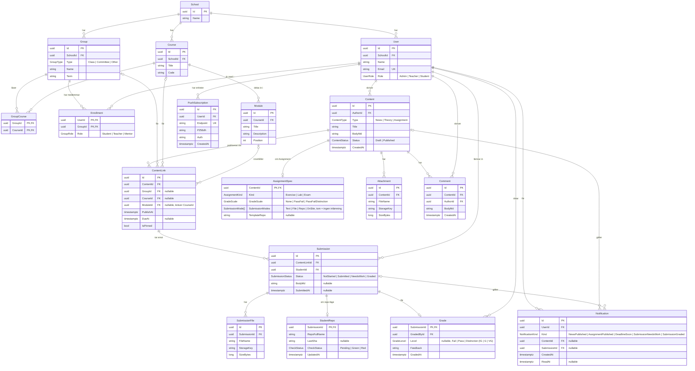

# RebornLMS – ER-modell

Datamodellen bakom API:et. Content (nyheter, teori och uppgifter) är kärnan: det lever fristående, skrivs alltid av en användare och publiceras till grupper och kurser via `ContentLink`.

Varje relation är en riktig foreign key i databasen med ett index. Modellen gäller Postgres: lokalt i Docker, i testerna via Testcontainers och i prod på Supabase.

Modellen beslutades i #34 och byggs i #37 (organisation), #38 (content), #39 (uppgifter och inlämningar) och #40 (notiser). Moduler (veckor) kom till i #61.

## Varför relationerna ser ut så här

### Organisation

- **School → User, Group, Course.** Allt hör till en skola. En användare tillhör en skola.
- **GroupCourse (Group ↔ Course, M:N).** En klass läser flera kurser och en kurs kan läsas av flera klasser. Det här är den enda kopplingen mellan kurs och grupp. Det fanns tidigare även `Course.ProgramGroupId` ("ägande program"), men två kopplingar som kan säga olika saker togs bort till förmån för en. Committee-grupper har inga rader här.
- **Module (Course → Module, 1:N)** delar in en kurs i delar, oftast veckor ("Vecka 2 – E2E och releasehantering"). `Position` är ordningen i kursen, 1, 2, 3 … utan luckor. Den är inte unik i databasen, eftersom en omsortering uppdaterar raderna en i taget och då skulle krocka med sig själv på vägen.
- **Enrollment (User ↔ Group, M:N) med `Role`.** Rollen gäller _i gruppen_, så en lärare kan vara student i en annan grupp. Den är en enum i stället för fri text, så ett stavfel inte kan göra att en elev försvinner ur sin grupp. `User.Role` är fortfarande användarens roll i systemet (Admin, Teacher, Student).

### Content

- **Content skrivs alltid av en User (`AuthorId`, obligatorisk).** Content lever för sig själv och är inte bundet till en grupp, så samma teorimaterial kan återanvändas för flera klasser.
- **ContentLink publicerar content** till en grupp, en kurs eller båda (minst en av `GroupId` och `CourseId` måste vara satt, det kontrolleras med en check constraint):
  - bara grupp: t.ex. en nyhet till NET25
  - bara kurs: alla grupper som läser kursen (via GroupCourse)
  - grupp + kurs: kursen så som den går för just den gruppen
- **`ModuleId` på länken lägger innehållet i en av kursens moduler.** Den är valfri, så nyheter och sådant som gäller hela kursen fungerar som förut. En modul kräver `CourseId` (check constraint), och backend kontrollerar att modulen hör till just den kursen. Den ligger på länken av samma skäl som deadlinen: samma material kan ligga i vecka 2 för en klass och vecka 3 för en annan.
- **`PublishAt`, `DueAt` och `IsPinned` ligger på länken, inte på content.** Samma uppgift kan delas ut till två klasser med olika deadlines.
- **AssignmentSpec (1:0..1 med Content)** finns bara när `Type = Assignment`. Tre fält styr uppgiften, och de motsvarar formuläret "Skapa del":
  - `Kind` är typen av del: `Exercise` (övning, ingen betygsättning), `Lab` (laboration, en betygsatt del) eller `Exam` (inlämning som examinerar). Det är en egen enum på AssignmentSpec och inte fler värden i `ContentType`, så content är fortfarande bara nyhet, teori eller uppgift. En övning kan inte ha betygsskala.
  - `GradeScale` är betygsskalan: `None` (bara feedback), `PassFail` (IG-G) eller `PassFailDistinction` (IG-G-VG).
  - `SubmissionModes` är hur man lämnar in, en lista där flera sätt kan kombineras: `Text` (textsvar i `Submission.BodyMd`), `File` (filer och foton), `Repo` (GitHub, kräver `TemplateRepo`) och `OnSite` (läraren bedömer på plats). En tom lista betyder ingen inlämning, t.ex. "läs kapitel 3". Listan sparas som en array i databasen.

  GitHub är ett tillval, så kurser utan programmering lämnar in text eller filer.

- **Attachment och Comment** hör till content, inte till en länk. Bilagorna följer med när innehållet delas ut igen.
- **Filer ligger i en privat bucket, inte i databasen.** Attachment och SubmissionFile sparar `StorageKey` (`content/{contentId}/{guid}` respektive `submissions/{submissionId}/{guid}`), aldrig filnamnet eleven skickade och aldrig en url. Svaren innehåller en kortlivad länk som skapas när filen läses.

### Inlämningar

- **Submission hör till en ContentLink, inte till content.** Det är på länken deadlinen finns, och en elev lämnar in till uppgiften så som den delades ut till hens grupp. Det finns en rad per elev och länk (unik), och `Status` (`NotStarted`, `Submitted`, `NeedsWork`, `Graded`) visar var eleven är. Statusbytena styr notiserna.
- **SubmissionFile (1:N)** innehåller uppladdade filer, **StudentRepo (1:0..1)** elevens GitHub-repo när uppgiften använder repo-läge. Repot skapas när uppgiften delas ut, så då finns submission-raden redan med status `NotStarted`.
- **Grade (1:0..1 med Submission)** sparar vem som rättade (`GradedById`) och när. `Level` är betyget (`Fail`, `Pass`, `Distinction`, alltså IG, G, VG) och måste passa uppgiftens `GradeScale`: på `PassFail` finns inget `Distinction`, och på `None` får inlämningen bara feedback. Vid komplettering sätts status `NeedsWork` och Grade har feedback men inget betyg, och eleven kan lämna in igen. En rättad inlämning går inte att lämna in igen. Uppgifter med `OnSite` kan rättas utan att eleven lämnat in något.

### Notiser

- **Notification** är _vad som hände_ för en användare (t.ex. ny nyhet, uppgift rättad), med valfri länk till content eller submission. Den visas i appen och `ReadAt` markerar den som läst.
- **PushSubscription** är _vart_ en pushnotis ska skickas: en rad per enhet (mobil, dator) som användaren har tillåtit notiser på. Den är `Endpoint` + nycklarna webbläsaren ger. Saknas rader skickas ingen push, men notisen finns ändå i appen.

## Delete-regler

| Relation                                                   | Vid delete av förälder                               |
| ---------------------------------------------------------- | ---------------------------------------------------- |
| School → User, Group, Course                               | blockeras (Restrict)                                 |
| Group, Course → GroupCourse, Enrollment, ContentLink       | blockeras                                            |
| Course → Module, Module → ContentLink                      | blockeras                                            |
| User → Content, Comment, Submission, Grade, Enrollment     | blockeras                                            |
| Content → ContentLink, AssignmentSpec, Attachment, Comment | kaskad                                               |
| ContentLink → Submission                                   | blockeras (elevarbete ska inte försvinna av misstag) |
| Submission → SubmissionFile, StudentRepo, Grade            | kaskad                                               |
| User → Notification, PushSubscription                      | kaskad                                               |
| Content, Submission → Notification                         | sätts till null                                      |

Principen: det man äger raderas med en (content med sina bilagor, en inlämning med sina filer). Delade saker (skolor, grupper, kurser, användare) och elevernas arbete går inte att radera så länge något pekar på dem.

## Unika regler

- `User.Email`
- `Group (SchoolId, Name, Term)`
- `Course (SchoolId, Code)`
- `Submission (ContentLinkId, StudentId)`
- `PushSubscription.Endpoint`

## Enums

Enums sparas som text i databasen (t.ex. `"Student"`), så att tabellerna går att läsa direkt i Supabase.
