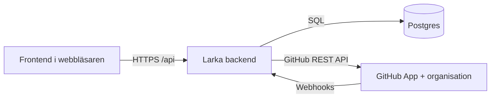
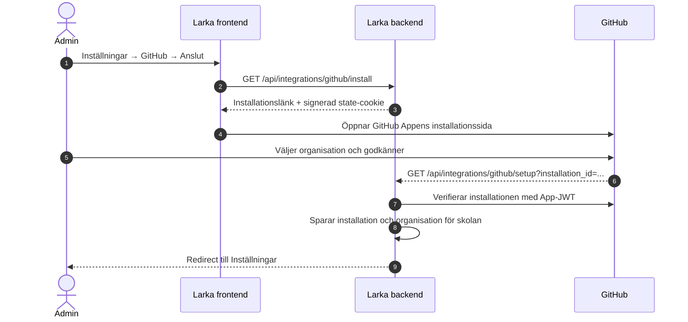
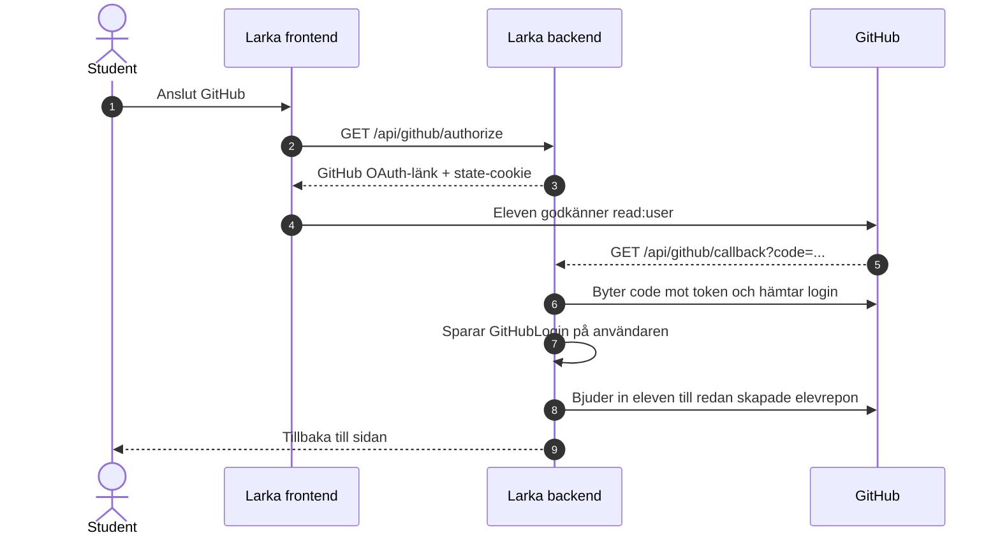
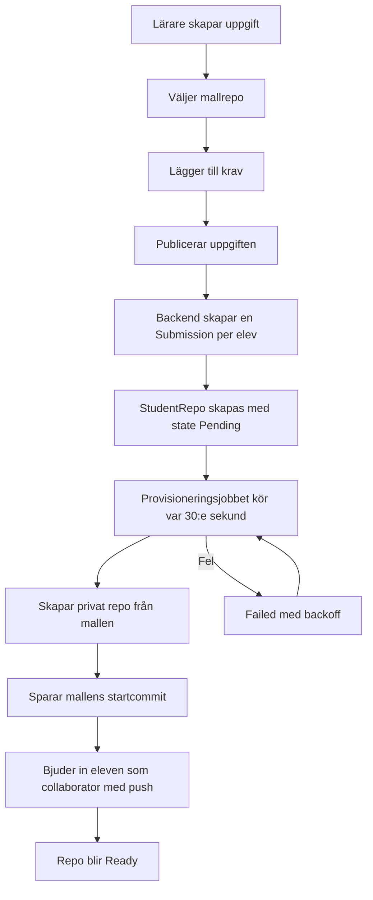
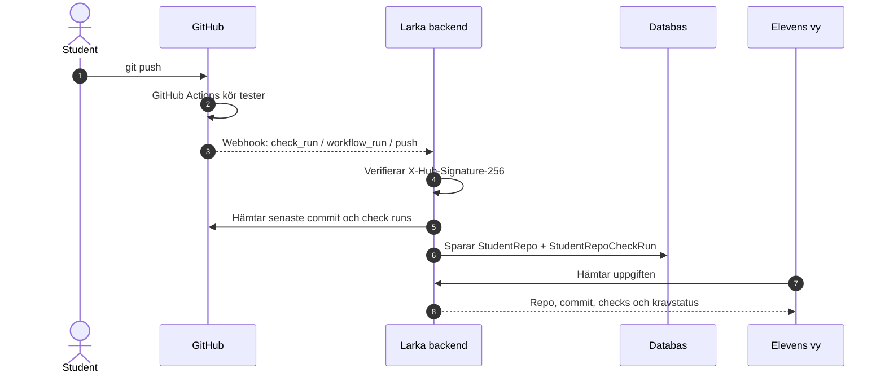
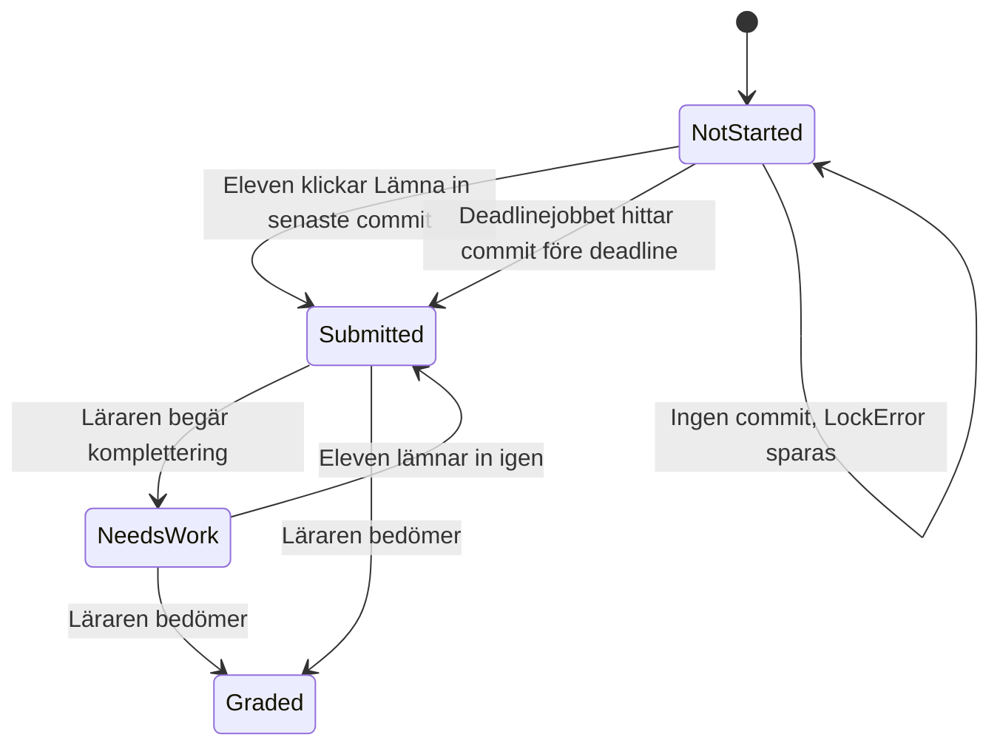

# GitHub-integrationen

Den här sidan förklarar hur GitHub-integrationen fungerar i Larka, från att en skola ansluter sin organisation till att eleven ser tester och krav i uppgiftsvyn.

GitHub är **inte** en inloggningsmetod i Larka. GitHub används bara för kodrepon, commits och testresultat. GitHub Appen är inte heller en AI-agent – det är en integration som Larka installerar i skolans GitHub-organisation.

## Begrepp

| Begrepp          | Betydelse i Larka                                                                                                         |
| ---------------- | ------------------------------------------------------------------------------------------------------------------------- |
| **GitHub Appen** | Den gemensamma GitHub-integrationen. En app för plattformen, men en installation per skola.                               |
| **Installation** | Skolans koppling mellan GitHub Appen och skolans organisation. Innehåller ett `installation_id` och organisationens namn. |
| **Organisation** | Skolans GitHub-organisation. Alla elevrepon ägs av organisationen, inte av elevens privata konto.                         |
| **Mallrepo**     | Ett privat GitHub-repo markerat som **Template repository**. Elevrepon skapas från mallen.                                |
| **Elevrepo**     | Ett privat repo per elev och uppgift. Eleven är collaborator med `push`, inte ägare.                                      |
| **Check run**    | Ett testresultat från GitHub Actions. Namnet är jobbets namn, till exempel `build` eller `test (ubuntu-latest)`.          |
| **Krav**         | En rad i uppgiften som antingen matchas mot check runs eller bedöms manuellt av läraren.                                  |
| **Stödsignal**   | Automatisk signal till läraren, till exempel “Inte startat”, “Ingen push” eller “Röda tester”.                            |

## De tre delarna och deras ansvar



### GitHub Appen

GitHub Appen sköter allt som händer på GitHub-sidan:

- autentiserar mot GitHub med appens privata nyckel och ett installations-token,
- skapar privata elevrepon från mallrepon,
- bjuder in eleven som collaborator med `push`,
- läser commits, check runs och jobbnamn från mallens workflows,
- arkiverar och avarkiverar repon vid deadline och komplettering,
- skickar webhooks när något händer i ett repo.

Appen har bara de behörigheter den behöver:

| Behörighet              | Varför                                   |
| ----------------------- | ---------------------------------------- |
| `contents: write`       | Skapa repon från mall och läsa innehåll. |
| `administration: write` | Arkivera och avarkivera repon.           |
| `checks: read`          | Läsa testresultat.                       |
| `actions: read`         | Läsa workflow-information.               |
| `metadata: read`        | Grundläggande repo-metadata.             |

### Larka backend

Backend är den enda delen som har GitHub-hemligheter och som pratar med GitHub API. Den:

- sparar skolans installation och organisation,
- sparar elevens GitHub-login,
- skapar `StudentRepo`-rader när en uppgift delas ut,
- kör bakgrundsjobben som skapar repon, låser vid deadline och pollar checks,
- verifierar webhook-signaturer,
- räknar ut stödsignaler,
- skickar bara notiser när eleven själv flaggar “Jag behöver hjälp”.

### Frontend

Frontend visar bara data som backend redan har sparat. Den:

- visar GitHub-inställningar för admin,
- visar koppla/koppla från GitHub för eleven,
- visar repo, senaste commit, check runs och krav i elevvyn,
- visar lärartrackingen med push, commits, tester och stödsignaler,
- uppdaterar lärartrackingen automatiskt var 30:e sekund när fliken är synlig och när fönstret får fokus.

Frontend får aldrig appens privata nyckel, client secret, webhook secret eller installations-token.

---

## Flöde 1: Skolan ansluter GitHub



1. Admin öppnar **Inställningar → GitHub**.
2. Backend skapar en installationslänk och en signerad, HttpOnly state-cookie.
3. Admin väljer skolans organisation i GitHub.
4. GitHub skickar tillbaka `installation_id` till backend.
5. Backend verifierar installationen mot GitHub och sparar `SchoolGitHubInstallation`.
6. Admin kan sedan aktivera eller pausa integrationen.

Viktigt: installationen är per skola. Samma GitHub App används av alla skolor, men varje skola har sin egen organisation och sitt eget `installation_id`.

### Organisationsinställningar

För att elever bara ska se sina egna repon ska organisationen ha:

- **Base permissions: No permission**,
- medlemmars repo-skapande, radering och visibility-ändring avstängt,
- tvåfaktorsautentisering,
- inga team som ger hela klassen åtkomst till individuella elevrepon.

Detta beskrivs också i [konfiguration.md](konfiguration.md#säkerhetskrav-i-github-organisationen).

---

## Flöde 2: Eleven ansluter sitt GitHub-konto



- OAuth används bara för att läsa GitHub-login (`read:user`).
- Token sparas inte efter att login hämtats.
- En GitHub-login kan bara vara kopplad till en Larka-användare.
- Om eleven redan har elevrepon bjuds hen in till dem direkt.
- När eleven kopplar från tar backend bort collaborator-åtkomsten men raderar aldrig repon.

GitHub-kortet på profilen visas bara när skolan använder GitHub.

---

## Flöde 3: Läraren skapar och publicerar en repo-uppgift



### Mallrepo

Läraren väljer ett repo som är markerat som **Template repository** i GitHub. Backend hämtar listan från GitHub Appens installation. Mallen ska vara privat.

### Krav

Läraren kan lägga till krav i uppgiften:

- **Testkrav** matchas mot check runs. Mönstret kan innehålla `*`, till exempel `*test*`.
- **Manuella krav** matchas inte mot GitHub. De visas som “Bedöms av lärare”.

Knappen **Läs in från mallen** läser **jobbnamn** från `.github/workflows/*.yml|yaml` i mallrepot. Det är samma namn som GitHub Actions använder för check runs. Den läser alltså inte workflowets namn, stegnamn eller enskilda testmetoder. Matrix-jobb matchas även när GitHub lägger till ett suffix, till exempel `build (ubuntu-latest)`.

Har krav redan sparats med ett gammalt mönster kan läraren behöva läsa in från mallen igen eller ändra mönstret manuellt.

### Utdelning

När uppgiften publiceras skapas en inlämning per elev. I repo-läge skapas också en `StudentRepo`-rad med:

- mallrepo,
- önskat reponamn,
- state `Pending`.

Själva GitHub-anropet görs sedan i bakgrunden. Publiceringen behöver därför inte vänta på GitHub.

### Provisionering

`GitHubProvisioningJob` körs var 30:e sekund och:

1. plockar upp `Pending` eller `Failed`-rader,
2. skapar ett privat repo i skolans organisation från mallen,
3. sparar mallens första commit som startpunkt,
4. bjuder in eleven om hen redan har kopplat GitHub,
5. sätter repot till `Ready`.

Om eleven saknar GitHub-login skapas repot ändå. Eleven bjuds in automatiskt när hen kopplar sitt konto senare.

Vid fel sätts state `Failed`, ett läsbart fel sparas och jobbet försöker igen med backoff.

---

## Flöde 4: Eleven pushar och testerna uppdateras



### Webhook är den snabba vägen

GitHub skickar webhooks till:

```text
POST /api/webhooks/github
```

Backend:

1. läser rå body,
2. verifierar `X-Hub-Signature-256` med `GitHub:WebhookSecret`,
3. accepterar bara `check_run`, `workflow_run` och `push`,
4. hittar elevrepot via `repository.full_name`,
5. uppdaterar endast det repot.

Webhooken är anonym eftersom GitHub inte skickar Larkas JWT. Signaturen är i stället beviset på att anropet kommer från GitHub.

### Fallback-poll var 6:e timme

Om en webhook missas kör `GitHubChecksJob` som fallback. Den uppdaterar alla elevrepon vid start och sedan var 6:e timme.

Läraren kan också trycka **Uppdatera** i lärartrackingen. Då uppdateras endast reporna för den uppgiften.

### Check-status

Backend sammanfattar check runs så här:

| Läget     | Betydelse                                                                  |
| --------- | -------------------------------------------------------------------------- |
| `Pending` | Inga checks än, eller minst en check körs fortfarande.                     |
| `Red`     | Minst en check har en felstatus, till exempel `failure` eller `timed_out`. |
| `Green`   | Alla checks är klara och ingen har en felstatus.                           |

De senaste check runs sparas som en snapshot i databasen. Elevvyn behöver därför inte fråga GitHub varje gång sidan laddas.

### Från check runs till kravstatus

Elevvyn matchar varje testkrav mot de sparade check runs:

| Kravstatus           | När den visas                                                                |
| -------------------- | ---------------------------------------------------------------------------- |
| **Väntar på test**   | Inget check run matchar mönstret än.                                         |
| **Godkänd**          | Alla matchande checks är klara och har `success`, `neutral` eller `skipped`. |
| **Underkänd**        | Minst en matchande check är inte klar eller har en felstatus.                |
| **Bedöms av lärare** | Kravet är manuellt och matchas inte mot GitHub.                              |

---

## Flöde 5: Inlämning, deadline och komplettering



### Eleven lämnar in själv

För repo-uppgifter finns knappen **Lämna in senaste commit** i elevens inlämningspanel. Den:

- sätter inlämningens status till `Submitted`,
- sparar aktuell commit som `SubmissionSha`,
- sparar tiden för inlämningen.

Eleven kan lämna in igen fram till deadline.

### Deadline låser repot

`GitHubDeadlineLockJob` körs var 60:e sekund. När en uppgift har passerat deadline:

1. hämtar backend senaste commit **före deadline**,
2. uppdaterar commit, commits och check runs,
3. arkiverar repot i GitHub,
4. sparar `SubmissionSha` och `LockedAt`,
5. sätter inlämningen till `Submitted` om det finns en commit.

Om det inte finns någon commit sparas `LockError = "Ingen commit före deadline."` och inlämningen förblir `NotStarted`.

### Komplettering

När läraren begär komplettering:

- sätts inlämningen till `NeedsWork`,
- avarkiveras repot,
- `ReopenedAt` sätts.

Eleven kan då pusha igen och lämna in på nytt. Nästa gång läraren låser repon arkiveras det igen och `ReopenedAt` rensas.

---

## Stödsignaler

Lärarens tabell visar automatiska signaler. De skickar inga notiser – de finns bara i tabellen.

| Signal           | Villkor                                                                                                   | Standard  |
| ---------------- | --------------------------------------------------------------------------------------------------------- | --------- |
| **Inte startat** | Repot är `Ready`, eleven har inte gjort någon commit efter mallens startcommit och det har gått 3 dagar.  | 3 dagar   |
| **Ingen push**   | Eleven har startat, inlämningen är `NotStarted` eller `NeedsWork` och senaste commit är äldre än 4 dagar. | 4 dagar   |
| **Röda tester**  | Repot har varit `Red` i minst 36 timmar.                                                                  | 36 timmar |
| **Elevflagga**   | Eleven har själv klickat **Jag behöver hjälp** och flaggan är öppen.                                      | –         |

Trösklarna går att ändra med `GitHub:Support:*`, se [konfiguration.md](konfiguration.md#github).

Elevflaggan är binär: **öppen** eller **löst**. När eleven flaggar skickas en notis till lärarna på uppgiften. När läraren markerar den som löst stängs den.

---

## Vad som visas var i frontend

| Vy                   | Komponent                               | Visar                                                                   |
| -------------------- | --------------------------------------- | ----------------------------------------------------------------------- |
| Inställningar, admin | `SettingsView.vue`                      | Anslut/pausa/koppla från GitHub, organisation, behörigheter och mallar. |
| Inställningar, elev  | `SettingsView.vue`                      | Ditt GitHub-konto, ansluten/inte ansluten och koppla från.              |
| Idag, elev           | `GitHubOnboardingBanner.vue`            | Avvisningsbar CTA om eleven saknar GitHub-koppling.                     |
| Skapa uppgift        | `CreateContentView.vue`                 | Mallrepo, reponamn, kravtabell och “Läs in från mallen”.                |
| Elevens uppgift      | `GitHubAssignmentBlock.vue`             | Repo-länk, senaste commit, teststatus och kravstatus.                   |
| Elevens inlämning    | `SubmissionPanel.vue`                   | **Lämna in senaste commit**, inlämnad commit och datum.                 |
| Lärartrackingen      | `PartView.vue` + `SubmissionsPanel.vue` | Push, commits, tester, stödsignaler, uppdatera, klona alla och lås.     |
| Granskning           | `ReviewView.vue`                        | Commit, antal commits, tester X/Y och lista med check runs.             |

Lärartrackingen uppdaterar sig automatiskt var 30:e sekund när fliken är synlig och när fönstret får fokus. Elevvyn uppdateras när sidan laddas om.

---

## Data som sparas

| Data                            | Var den finns              | Varför                                                      |
| ------------------------------- | -------------------------- | ----------------------------------------------------------- |
| Skolans installation            | `SchoolGitHubInstallation` | Koppla skola till organisation och installation.            |
| Elevens GitHub-login            | `User.GitHubLogin`         | Bjuda in till repon och visa kopplad status.                |
| Uppgiftens GitHub-inställningar | `AssignmentSpec`           | Mallrepo, reponamn, deadline-lås och inlämningssätt.        |
| Krav                            | `AssignmentRequirement`    | Elevtext, testmönster och manuell bedömning.                |
| Elevrepo                        | `StudentRepo`              | Repo-namn, commit, check-status, låsning och komplettering. |
| Check runs                      | `StudentRepoCheckRun`      | Kravstatus utan ett GitHub-anrop per sidladdning.           |
| Elevens hjälpflagga             | `StudentHelpRequest`       | Öppen/löst flagga och notis till lärare.                    |

---

## Fel och felsökning

| Symptom                       | Vanlig orsak                                                                        | Åtgärd                                                             |
| ----------------------------- | ----------------------------------------------------------------------------------- | ------------------------------------------------------------------ |
| Repot står kvar som `Pending` | Provisioneringsjobbet är avstängt eller GitHub-anropet felar.                       | Kontrollera jobbet och felet i `StudentRepo.ProvisioningError`.    |
| Repot blir `Failed`           | Mallen är inte ett template-repo, namnet är upptaget eller appen saknar behörighet. | Kontrollera mallen, reponamnet och appens behörigheter.            |
| Inga checks syns              | Inga workflows har kört än, eller check runs är inte klara.                         | Vänta, kontrollera GitHub Actions och tryck **Uppdatera**.         |
| Krav står “Väntar på test”    | Kravets mönster matchar inget jobbnamn i repots check runs.                         | Läs in från mallen igen eller ändra mönstret till jobbnamnet.      |
| Webhook uppdaterar inte       | Fel secret, fel event eller avstängd webhook.                                       | Kontrollera leveransen i GitHub och `GitHub:WebhookSecret`.        |
| Eleven ser inte repot         | Eleven saknade GitHub-login när repot skapades.                                     | Låt eleven koppla GitHub; backend bjuder in till befintliga repon. |
| Eleven ser andra repon        | Organisationens basbehörighet är för bred.                                          | Sätt **Base permissions** till **No permission**.                  |
| Frontend visar gammal status  | Sidan har inte uppdaterats.                                                         | Läraren får automatisk uppdatering; eleven laddar om sidan.        |

---

## Avgränsningar i fas 1

Det här är med i första versionen:

- individuella elevrepon,
- en GitHub-organisation per skola,
- repo-uppgifter med mallrepo,
- check runs och krav,
- deadline-låsning och komplettering,
- stödsignaler och elevflagga.

Det här är inte med än:

- grupprepon,
- feedback-PR:er,
- sena inlämningar,
- dolda tester,
- automatisk testmetodsinläsning från mallrepot.

---

## Kodkarta

| Område                  | Fil                                                              |
| ----------------------- | ---------------------------------------------------------------- |
| GitHub API              | `backend/Infrastructure/GitHub/GitHubAppService.cs`              |
| OAuth för elev          | `backend/Infrastructure/GitHub/GitHubOAuthService.cs`            |
| Skolans anslutning      | `backend/Infrastructure/GitHub/GitHubConnectionService.cs`       |
| Elevrepon               | `backend/Infrastructure/Labs/GitHubLabProvisioner.cs`            |
| Provisioneringsjobb     | `backend/Infrastructure/GitHub/GitHubProvisioningJob.cs`         |
| Deadlinejobb            | `backend/Infrastructure/GitHub/GitHubDeadlineLockJob.cs`         |
| Fallback-poll           | `backend/Infrastructure/GitHub/GitHubChecksJob.cs`               |
| Webhook                 | `backend/Api/Endpoints/GitHubWebhookEndpoints.cs`                |
| Elevens GitHub-koppling | `backend/Application/Services/GitHubLinkingService.cs`           |
| Stödsignaler            | `backend/Application/Services/Students/StudentSupportService.cs` |
| Kravmodell              | `backend/Domain/Entities/AssignmentRequirement.cs`               |
| Elevens GitHub-block    | `client/src/components/GitHubAssignmentBlock.vue`                |
| Elevens inlämning       | `client/src/components/student/SubmissionPanel.vue`              |
| Lärartrackingen         | `client/src/components/course/SubmissionsPanel.vue`              |
| Onboarding              | `client/src/components/GitHubOnboardingBanner.vue`               |
