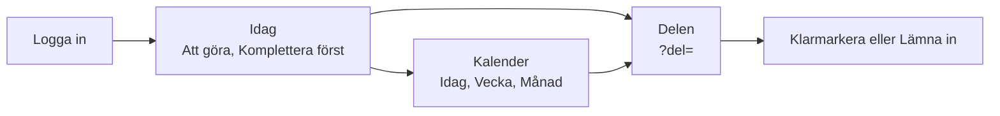
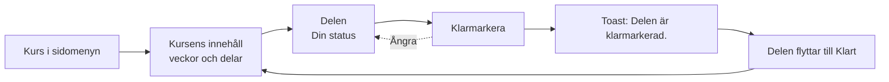
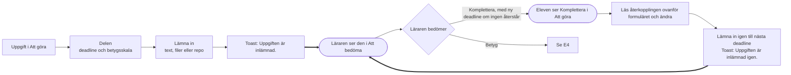
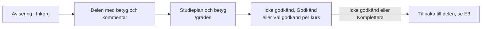
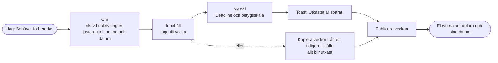
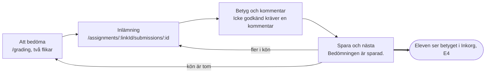
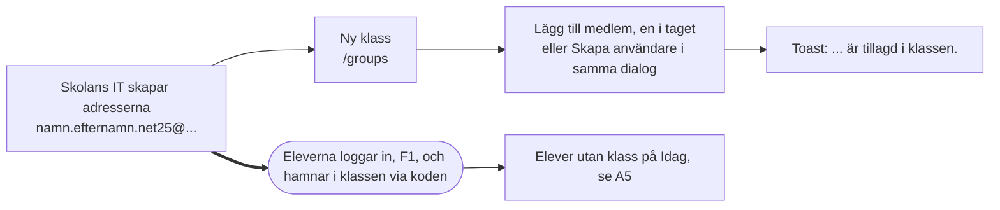
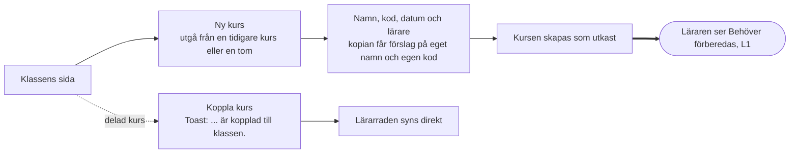
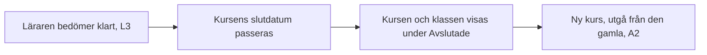
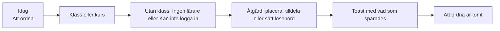

# Roller och flöden

Admin bestämmer vem som undervisar vad, och läraren bestämmer vad som händer i kursen. Eleven läser och lämnar in.

Modellen beslutades 30 oktober 2026 och byggs i #269. Per kurs-lärare är #274, klassidans flöde är #275 och separationen av admin är #276.

## Roller

Den globala rollen säger vad du administrerar. Din koppling till en kurs eller klass säger vad du gör där.

|                                          | Admin                         | Lärare, egna kurser | Elev               |
| ---------------------------------------- | ----------------------------- | ------------------- | ------------------ |
| Skola, användare, integrationer          | Hanterar                      | –                   | –                  |
| Klasser, inskrivning, lärare på kurs     | Hanterar                      | Läser klasslistan   | Egna klasskamrater |
| Skapa och ta bort kurser                 | Hanterar                      | –                   | –                  |
| Kursens titel, poäng, datum, beskrivning | Hanterar (utom beskrivningen) | Hanterar            | Läser              |
| Veckor, innehåll, nyheter                | Läser                         | Hanterar            | Läser publicerat   |
| Inlämningar och betyg                    | –                             | Hanterar            | Bara egna          |
| Lämna in, kommentera, klarmarkera        | –                             | –                   | Ja                 |
| Ta bort kommentarer                      | Bara egna                     | Alla i kursen       | Bara egna          |

**Vem ändrar vad på en kurs.** En lärare som är tilldelad kursen får ändra kursens titel, poäng, datum och beskrivning, och bygger veckorna och innehållet. Admin skapar och tar bort kurser och tilldelar lärarna. Det finns ingen arkivering: en kurs är avslutad när slutdatumet har passerat, och en klass när alla dess kurser är det. Beskrivningen är lärarens egen text, så admin skriver den inte.

Admin undervisar aldrig, inte heller i en kurs admin själv har skapat. Bara användare med rollen Lärare kan vara lärare i en kurs eller klass, och admin kan inte välja sig själv. Är en lärare sjuk tilldelar admin en vikarie. Betyget visar alltid vem som formellt var lärare. Beslutat 4 november 2026 i #491.

**Den som både leder och undervisar** har två konton, ett med rollen Admin och ett med rollen Lärare, till exempel `anna.admin@skolan.se` och `anna@skolan.se`. Varje Microsoft-konto blir ett eget konto i Lärka, så skolans IT skapar det andra kontot. Ett separat konto för adminarbete är också vanlig säkerhetspraxis. Två webbläsarprofiler gör det lätt att byta. Det nya kontot blir elev vid första inloggningen, och admin ger det rätt roll under Användare.

**Byta roll.** En lärare som undervisar i en kurs eller klass behåller rollen Lärare tills admin har ersatt hen där. Då blir ingen kurs utan lärare av misstag.

Eleven ser namn på dem i samma grupp, och kontaktuppgifter till kursens lärare. Aldrig andras inlämningar, betyg eller framsteg.

## Skolans år

Sidorna byggs efter arbetet, inte efter databasens objekt.

1. **Sätt upp klassen (admin, en gång).** Skapa klassen, lägg in eleverna.
2. **Planera terminen (admin, några gånger om året).** Skapa varje kurs från klassens sida, med datum och lärare. Har kursen gått förut utgår admin från den tidigare kursen, så följer namn, omfattning, lärare och valda veckor med.
3. **Förbered kursen (lärare).** Kursen syns i Idag under Behöver förberedas när beskrivningen är tom, eller när kursen inte har börjat och saknar publicerade delar. Läraren skriver beskrivningen, bygger veckorna eller kopierar dem från ett tidigare tillfälle och publicerar.
   En ny, tom vecka är också ett utkast och syns inte för eleverna förrän den har en publicerad del. Allt kopierat är utkast. En vecka med bara utkast syns inte för eleverna, oavsett datum, tills läraren väljer Publicera veckan eller Publicera alla veckor. Delarna syns sedan på sina egna datum. Lärarens kalender visar _Publiceras_ när eleverna får se en publicerad del, alltså det senare av delens och veckans datum. Utkast får ingen sådan händelse.
4. **Kör kursen (lärare och elev, varje vecka).** Läraren publicerar och bedömer, eleven läser och lämnar in. Här ligger nästan all tid i appen.
5. **Stäng och upprepa (lärare, sedan admin).** Läraren bedömer klart, kursen tar slut och nästa tillfälle utgår från det gamla.

## Var saker hör hemma

- **Klassen** är en årskull och håller eleverna. Den har ingen beskrivning.
- **Kursen** håller lärarna, veckorna och innehållet. Varje rad är ett tillfälle med egna datum, så de flesta kurser hör till en klass.
- **Klassens sida** är admins arbetsyta. Ny kurs är den primära handlingen där och finns bara på en klass eller grupp, inte på Alla grupper: först väljer admin en tidigare kurs eller en tom kurs, sedan namn, kod, omfattning, datum och lärare, och kursen skapas, kopplas till klassen och får sina lärare i ett flöde. Att ordna visar vad som återstår tills klassen har kurser och elever. Koppla kurs är för en kurs som delas mellan klasser. Varje kursrad visar lärarna, och en kurs utan lärare har märket Ingen lärare. Där lägger admin också in elever och lärare, en i taget, med _Lägg till medlem_: admin väljer en användare i skolan och en roll i klassen. Finns personen inte än väljer admin _Skapa användare_ i samma dialog, med namn, e-post, skolroll och ett lösenord som kan lämnas tomt. Har skolan Microsoft-inloggning sätts inget lösenord, och eleverna hamnar i klassen själva vid första inloggningen, via klasskoden i adressen.
- **Kursbeskrivningen** är lärarens text och valfri. Admin skriver den inte när kursen skapas.

## Inlämning och bedömning

Deadlinerna bestämmer när eleven får lämna in och vad läraren får sätta. Reglerna bor på ett ställe i backend (`GradingWindow`) och klienten räknar inget själv: backend skickar `DeadlineStateDto` (`deadline`) på inlämningen och klienten visar det. Beslutade i #403.

**Deadlines.** Uppgiften har en huvuddeadline och högst fem kompletteringsdeadlines (`ResubmitDueAt`). Nästa deadline är den första av dem som ligger efter nu, jämförd i UTC.

- **Fram till huvuddeadlinen** får alla lämna in och ändra sin inlämning.
- **Efter en deadline** får den som inte är godkänd och inte väntar på bedömning (Inte inlämnad, Komplettera) lämna in fram till nästa deadline som återstår (en kompletteringsdeadline eller elevens egen), utan att vänta på läraren.
- **En Inlämnad inlämning låses** när huvuddeadlinen har gått, tills läraren har bedömt den.
- **Efter sista deadline** går inget att lämna in.

**Automatiskt IG.** När uppgiften har en deadline och ingen deadline återstår för eleven får den som inte lämnat in (Inte inlämnad) eller inte kompletterat (Komplettera) IG automatiskt. Det härleds alltid och sparas aldrig. Regeln bor i `GradingWindow.IsAutoFail` (backend), klienten läser `deadline.autoFail`, och elevens personliga deadline räknas med där (se nedan). Beslutade i #446.

- Inte inlämnad visas som _IG · Ingen inlämning_.
- Komplettera visas som _IG · Kompletteringen lämnades inte in_.
- Ett automatiskt IG räknas som klart på samma sätt som ett bedömt IG: delen lämnar elevens att göra-lista och låser upp nästa del.
- I klassens analys och elevens översikt räknas ett automatiskt IG som bedömt och som IG. Tre uppgifter med ett G och ett automatiskt IG ger _Bedömda 2 av 3 (G 1 · IG 1)_. `AutoFailCount` visar hur många av IG:na som kom av sig själva. Beslutade i #490.
- Läraren kan fortfarande ge eleven en personlig deadline efter ett automatiskt IG (`PUT /api/links/{id}/students/{studentId}/personal-due-at`). Då återstår en deadline, IG:t försvinner och eleven kan lämna in igen.
- Lämnade eleven in efter sista deadline gäller Väntar på bedömning, aldrig automatiskt IG. Bedömd visar lärarens betyg.
- Utan huvuddeadline blir det aldrig automatiskt IG.
- Vid bedömning på plats (`OnSite`) gäller automatiskt IG också, men läraren kan fortfarande sätta betyg direkt, och det betyget ersätter det automatiska IG:t.
- Före sista deadline ändras inget i reglerna. Eleven ser bara till när hen kan lämna in (_Du kan lämna in till …_, _Komplettera senast …_). I elevens vyer kallas delen aldrig Försenad så länge eleven har en deadline kvar, och i lärarens listor är eleven kvar under Väntar på eleven. I elevens studieplan står _Pågår · deadline …_ med elevens nästa deadline som återstår (också en kompletteringsdeadline eller en personlig), och _Deadline passerade …_ först när ingen återstår (#488).

**Försenad.** Ordet betyder olika saker för eleven och för läraren och admin. Beslutat 4 november 2026 i #513.

- **Lärarens och admins översikter** (klassens analys, elevens läge i klassen, _Väntar på eleven_) får säga _Försenad_ om en elev som är Inte inlämnad när klassens huvuddeadline har passerat men en deadline återstår för eleven (en kompletteringsdeadline eller elevens egen). Eleven har missat klassens deadline men har en chans kvar. Återstår ingen deadline är det automatiskt IG, inte Försenad.
- **Elevens vyer** säger aldrig Försenad, och inte att deadlinen har gått ut, så länge eleven har en deadline kvar. Eleven ser sin nästa deadline (_Din deadline …_, _Kompletteringsdeadline …_) och till när hen kan lämna in. En Inlämnad inlämning som låsts efter huvuddeadlinen visar _Inlämnad. Den är låst tills läraren har bedömt den._

**IG och Komplettera.** Läraren kan sätta IG för hand, bara när ingen deadline återstår och med en kommentar. Komplettera kräver en deadline som återstår. Finns ingen väljer läraren _Kompletteras senast_ i samma steg, och datumet sparas som elevens personliga deadline (`personalDueAt` i `POST /api/submissions/{id}/grade`, bara med `outcome: NeedsWork`). Läraren kan inte betygsätta en elev som inte lämnat in, utom vid bedömning på plats.

**Bedömningsvyn.** Överst står läget och vad som gäller för eleven (till exempel _Komplettering begärd · Eleven kan lämna in till …_ eller _IG · Ingen inlämning_). Under det kommer betyg, kommentar och knapparna, och sist _Ny deadline för eleven_. _Begär komplettering_ visas inte när kompletteringen redan är begärd. Har eleven lämnat in igen efter en bedömning börjar kommentaren tom och förra bedömningen står skrivskyddad ovanför (_Förra återkopplingen_), så att en gammal begäran om komplettering inte följer med ett nytt betyg. Rättar läraren den nuvarande bedömningen börjar formuläret från den. Byter läraren ett sparat IG mot G eller VG utan att ha ändrat kommentaren flyttas IG-kommentaren till _Förra återkopplingen_, och tillbaka till IG tar fram den igen (#514).

**Eleven vid komplettering.** Lärarens återkoppling står överst i _Din inlämning_, direkt ovanför formuläret, och sidokolumnen visar bara läget.

**Bara det senaste gäller.** Appen sparar bara den senaste bedömningen och ingen historik. Läraren kan alltid ändra en bedömning, även efter sista deadline. Det finns ingen varning när en elev ändrar medan läraren bedömer.

**Vem som bedömde.** Betyget visar läraren som satte det (`gradedByName` på betyget): _Bedömd av Tomas Berg ons 28 okt_ i bedömningsvyn och på elevens del, och _Bedömd av Tomas Berg_ i elevlistan. Det står kvar efter ett lärarbyte, så en vikarie ser vem som bedömde. Ett automatiskt IG har ingen lärare och visar inget namn (#512).

### Personlig deadline

Läraren kan ge en enskild elev en extra deadline (`Submission.PersonalDueAt`), till exempel efter sjukdom. Beslutade i #448.

- Den räknas som en deadline till bredvid huvuddeadlinen och kompletteringsdeadlinerna. `GradingWindow.Of(länk, inlämning, nu)` bygger elevens fönster, och `DeadlineStateDto.From` ger klienten resultatet.
- Den syns i elevens kalender (_Din deadline_), liksom kompletteringsdeadlinerna (_Kompletteringsdeadline_), och i Att göra. I månadsvyn har varje sort en egen ikon: flagga för deadline, pil bakåt för komplettering och person för den egna.
- Lärarens Idag visar under _Kommande deadlines_ också kompletteringsdeadlinerna och elevernas egna deadlines, med hur många elever de gäller (_Egen deadline · 1 elev_). Bedömda inlämningar räknas inte.
- Så länge den återstår får eleven lämna in (Inte inlämnad, Komplettera), läraren kan begära Komplettera men inte sätta IG, och det automatiska IG:t uteblir. När den passerat kommer det automatiska IG:t tillbaka.
- En Inlämnad inlämning låses som vanligt när huvuddeadlinen gått. Den personliga deadlinen ändrar inte det.
- Läraren sätter eller tar bort den i bedömningsvyn (_Ny deadline för eleven_). Raden i elevlistan visar _Egen deadline_, och eleven ser _Din deadline_ på delen.
- Reglerna: uppgiften måste ha en huvuddeadline, datumet måste ligga i framtiden och efter uppgiftens sista deadline (annars gör det ingen skillnad), och inlämningen får varken vara bedömd eller vänta på bedömning (då begär läraren komplettering i stället). Att ta bort den går alltid. Har eleven ingen inlämningsrad än skapas en (Inte inlämnad), om eleven hör till uppgiftens mottagare.
- Eleven får en notis (_Ny deadline för …_) när den sätts, inte när den tas bort. Den kan stängas av under inställningarna.
- API: `PUT /api/links/{id}/students/{studentId}/personal-due-at` med `{ dueAt }`. Bara lärarna på länken. `dueAt: null` tar bort den.
- GitHub-repot följer den personliga deadlinen: det står öppet tills även den passerat, och ett låst repo öppnas igen när läraren sätter ett datum för en elev som är Inte inlämnad eller Komplettera. Se [github-integration.md](github-integration.md#deadline-låser-repot). Beslutade i #449.

### Lägen

| Läge                         | Eleven får lämna in?                       | Läraren får sätta                                          |
| ---------------------------- | ------------------------------------------ | ---------------------------------------------------------- |
| Inte inlämnad (`NotStarted`) | Ja, till nästa deadline som återstår       | Inget, utom betyg vid bedömning på plats                   |
| Inlämnad (`Submitted`)       | Ändra fram till huvuddeadlinen, sedan låst | G eller VG. Komplettera om en deadline återstår, annars IG |
| Komplettera (`NeedsWork`)    | Ja, till nästa deadline som återstår       | IG när sista deadline har passerat                         |
| G eller VG (`Graded`)        | Nej                                        | Rätta ett misstag                                          |
| IG (`Graded`, `Fail`)        | Nej                                        | Rätta ett misstag                                          |

När ingen deadline återstår blir Inte inlämnad och Komplettera automatiskt IG (se ovan). Statusen i databasen ändras inte.

### Repo-uppgifter

Repot är öppet exakt när eleven får lämna in och låst annars. Vid varje deadline, huvud- och kompletteringsdeadlines, gäller:

- **Eleven har en egen commit:** repot låses, inlämningen blir Inlämnad och `SubmissionSha` är den commiten.
- **Ingen egen commit:** repot lämnas öppet till nästa deadline. Efter sista deadline låses alla repon.

Elevens egen commit är senaste commit före deadlinen när den skiljer sig från mallens första commit (`StudentRepo.InitialSha`). Efter en öppning (`ReopenedAt`) måste den dessutom vara en ny commit, inte den som lämnades in förra gången. Komplettera och en personlig deadline öppnar ett låst repo igen. Automatiskt IG rör inte repot.

### Att bedöma

Sidan _Att bedöma_ har två flikar, med antalet på varje, och raderna är grupperade per uppgift:

| Flik             | Innehåll                                                            | Läraren gör                          |
| ---------------- | ------------------------------------------------------------------- | ------------------------------------ |
| Inlämnat         | Inlämnade inlämningar                                               | Bedömer: G, VG, Komplettera eller IG |
| Väntar på eleven | Försenad eller Komplettera medan en deadline återstår, som översikt | Inget, eleven har en ny chans        |

Raden i Inlämnat visar _Första inlämningen_, eller _Inlämnat igen_ när en tidigare bedömning finns.

_Att bedöma_ listar bara det som väntar på läraren, och bara i kurser där användaren kan bedöma. En gruppuppgift räknas som en rad, både här, i delens _Att bedöma_ och i inlämningsfliken (samma radbyggare, `client/src/lib/submissionRows.ts`). Automatiskt IG kräver ingen åtgärd och syns därför inte där. Det syns i uppgiftens inlämningslista, med filtret _IG automatiskt_.

**Antal elever i räknarna.** "X av Y inlämnade" på veckolistan, i delen och på Idag räknar eleverna som delen delas ut till: länkens grupp, annars alla klasser som läser kursen. Avaktiverade elever räknas inte, på samma sätt som på klassens sida. Idag listar bara inlämningsuppgifter vars del och vecka redan är publicerade. Reglerna bor i `LinkAudience` (backend). Utdelning och gruppindelning behåller avaktiverade elever, så att en återaktiverad elev har sina inlämningar kvar (#485, #486).

### Specialfall

- **Uppgift utan deadline (`DueAt`):** ingen deadlinelogik gäller. Inlämning står öppen tills den är bedömd och alla utfall är tillåtna.
- **På plats (`OnSite`):** läraren bedömer utan inlämning. Bara tidsreglerna för IG och Komplettera gäller.
- **Grupprepon:** gruppens medlemmar delar repo, och statusen sätts för hela gruppen när repot låses.

## Användarflöden

Ett flöde per mål. Rutorna är sidor eller steg, och rutorna med dubbla kanter är överlämningar där nästa person får veta att det är deras tur. ID:na (F1, E1 och så vidare) används i E2E-testerna och i issues. Alla flöden slutar på en sida där användaren ser att det gick bra, med en toast eller en ruta på sidan.

### F1 · Första inloggningen

Alla roller. Rollen kommer aldrig från Microsoft, bara klassen från adressen.

### E1 · Se vad som ska göras

### E2 · Läsa veckan och klarmarkera

### E3 · Lämna in och komplettera

Efter huvuddeadlinen är en Inlämnad inlämning låst tills läraren har bedömt den. Den som inte lämnat in eller ska komplettera lämnar in fram till nästa deadline som återstår, också en personlig deadline. Efter sista deadline är uppgiften stängd och de som saknar inlämning får IG automatiskt, tills läraren ger eleven en ny deadline.

### E4 · Återkoppling och betyg

Överst i studieplanen visar den första rutan poäng. Bara en avslutad kurs med godkänt kursbetyg (G eller VG) räknas som avklarad (`completedPoints`). Kursbetyg finns inte i appen än, så rutan heter _Avslutade kurser_ och räknar poängen för kurser vars slutdatum har passerat (`endedPoints`), oavsett betyg. Får någon kurs ett kursbetyg heter den _Avklarade poäng_ och räknar bara de godkända. _Pågår nu_ listar alla kurser som pågår (#516).

### L1 · Förbereda kursen

Läraren tilldelas kursen av admin (A2). Allt kopierat och allt nytt är utkast tills läraren publicerar.

### L2 · Köra veckan

### L3 · Bedöma

Läraren väljer flik efter vad som väntar: Inlämnat bedöms och Väntar på eleven är en översikt. Automatiskt IG kräver inget och syns i uppgiftens inlämningslista. Överst på bedömningssidan står läget. Se _Inlämning och bedömning_ ovan.

### A1 · Sätta upp klassen

### A2 · Planera terminen

Kopians kod är källans kod med den nya klassen, till exempel `.NET27_DevOps` från `.NET25_DevOps`. Går kursen igen i samma klass är den koden redan tagen. Då läggs terminen från startdatumet till (`TE24A_Webb1_HT26`), och saknas startdatum ett löpnummer (`TE24A_Webb1_2`). Förslaget följer startdatumet tills admin skriver en egen kod.

### A3 · Byta lärare

### A4 · Stänga terminen

Ingen stänger terminen med en knapp. Avslutade kurser och klasser följer av datumen och flyttas till en hopfälld grupp _Avslutade_ i sidomenyn, i Alla grupper, på klassens sida, i kalenderns kursval och bland materialets flikar (_Visa avslutade_). Idag visar eleven bara pågående och kommande kurser, och läraren bara pågående kurser och avslutade med inlämningar kvar att bedöma. Avslutade kurser och klasser räknas inte som saknad lärare i _Att ordna_. Inget tas bort och ingen förlorar åtkomst: länkar, material, betyg, studieplan och _Att bedöma_ når allt. Kurser utan datum räknas som pågående.

### A5 · Ordna det som saknas

### Fel och behörighet

En sida som kräver en behörighet användaren saknar öppnas inte. Användaren hamnar på Idag med toasten "Du har inte behörighet till den sidan." Samma sak gäller en kurs, del eller grupp som användaren inte får öppna, till exempel en annan klass kurs eller en kurs läraren har tagits bort från, och en del eleven inte ser än (utkast eller schemalagd). Sidan skiljer inte på något som inte finns och något användaren inte får se. _Sidan finns inte_ visas bara för adresser som appen inte har. Fel från servern visas alltid på svenska: backends korta engelska meddelanden översätts i klienten (`client/src/lib/serverMessages.ts`), och okända fel får en allmän text efter statuskoden.
