# Roller och flöden

Admin bestämmer vem som undervisar vad, och läraren bestämmer vad som händer i kursen. Eleven läser och lämnar in.

Modellen beslutades 30 oktober 2026 och byggs i #269. Per kurs-lärare är #274, klassidans flöde är #275 och separationen av admin är #276.

## Roller

Den globala rollen säger vad du administrerar. Din koppling till en kurs eller klass säger vad du gör där.

|                                          | Admin                         | Lärare, egna kurser | Mentor, egen klass | Elev               |
| ---------------------------------------- | ----------------------------- | ------------------- | ------------------ | ------------------ |
| Skola, användare, integrationer          | Hanterar                      | –                   | –                  | –                  |
| Klasser, inskrivning, lärare på kurs     | Hanterar                      | Läser klasslistan   | Läser klasslistan  | Egna klasskamrater |
| Skapa och ta bort kurser                 | Hanterar                      | –                   | –                  | –                  |
| Kursens titel, poäng, datum, beskrivning | Hanterar (utom beskrivningen) | Hanterar            | Läser              | Läser              |
| Veckor, innehåll, nyheter                | Läser                         | Hanterar            | Läser              | Läser publicerat   |
| Inlämningar och betyg                    | –                             | Hanterar            | Läser              | Bara egna          |
| Lämna in, kommentera, klarmarkera        | –                             | –                   | –                  | Ja                 |

**Vem ändrar vad på en kurs.** En lärare som är tilldelad kursen får ändra kursens titel, poäng, datum och beskrivning, och bygger veckorna och innehållet. Admin skapar och tar bort kurser och tilldelar lärarna. Det finns ingen arkivering: en kurs är avslutad när slutdatumet har passerat, och en klass när alla dess kurser är det. Beskrivningen är lärarens egen text, så admin skriver den inte.

Admin har ingen genväg in i undervisningen. Är en lärare sjuk tilldelar admin en vikarie, eller sig själv om hen också undervisar. Betyget visar alltid vem som formellt var lärare.

Eleven ser namn på dem i samma grupp, och kontaktuppgifter till kursens lärare. Aldrig andras inlämningar, betyg eller framsteg.

## Skolans år

Sidorna byggs efter arbetet, inte efter databasens objekt.

1. **Sätt upp klassen (admin, en gång).** Skapa klassen, lägg in eleverna och utse mentor.
2. **Planera terminen (admin, några gånger om året).** Skapa varje kurs från klassens sida, med datum och lärare. Har kursen gått förut utgår admin från den tidigare kursen, så följer namn, omfattning, lärare och valda veckor med.
3. **Förbered kursen (lärare).** Kursen syns i Idag under Behöver förberedas när beskrivningen är tom, eller när kursen inte har börjat och saknar publicerade delar. Läraren skriver beskrivningen, bygger veckorna eller kopierar dem från ett tidigare tillfälle och publicerar.
   En ny, tom vecka är också ett utkast och syns inte för eleverna förrän den har en publicerad del. Allt kopierat är utkast. En vecka med bara utkast syns inte för eleverna, oavsett datum, tills läraren väljer Publicera veckan eller Publicera alla veckor. Delarna syns sedan på sina egna datum.
4. **Kör kursen (lärare och elev, varje vecka).** Läraren publicerar och bedömer, eleven läser och lämnar in. Här ligger nästan all tid i appen.
5. **Stäng och upprepa (lärare, sedan admin).** Läraren bedömer klart, kursen tar slut och nästa tillfälle utgår från det gamla.

## Var saker hör hemma

- **Klassen** är en årskull och håller elever och mentor. Den har ingen beskrivning.
- **Kursen** håller lärarna, veckorna och innehållet. Varje rad är ett tillfälle med egna datum, så de flesta kurser hör till en klass.
- **Klassens sida** är admins arbetsyta. Ny kurs är den primära handlingen där och finns bara på en klass eller grupp, inte på Alla grupper: först väljer admin en tidigare kurs eller en tom kurs, sedan namn, kod, omfattning, datum och lärare, och kursen skapas, kopplas till klassen och får sina lärare i ett flöde. Att ordna visar vad som återstår tills klassen har kurser, elever och mentor. Koppla kurs är för en kurs som delas mellan klasser. Varje kursrad visar lärarna, och en kurs utan lärare har märket Ingen lärare. Där lägger admin också in elever, en i taget eller genom att klistra in en lista med namn och e-post (nya elever skapas utan lösenord), och utser klassens mentor. Mentor är en roll i klassen och en klass har en mentor: att byta tar bort den förra ur klassen.
- **Kursbeskrivningen** är lärarens text och valfri. Admin skriver den inte när kursen skapas.

## Användarflöden

Ett flöde per mål. Rutorna är sidor eller steg, och rutorna med dubbla kanter är överlämningar där nästa person får veta att det är deras tur. ID:na (F1, E1 och så vidare) används i E2E-testerna och i issues. Alla flöden slutar på en sida där användaren ser att det gick bra, med en toast eller en ruta på sidan.

### F1 · Första inloggningen

Alla roller. Rollen kommer aldrig från Microsoft, bara klassen från adressen.

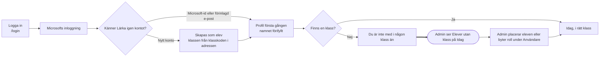

### E1 · Se vad som ska göras

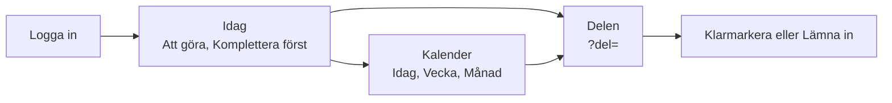

### E2 · Läsa veckan och klarmarkera

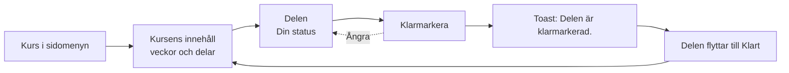

### E3 · Lämna in och komplettera

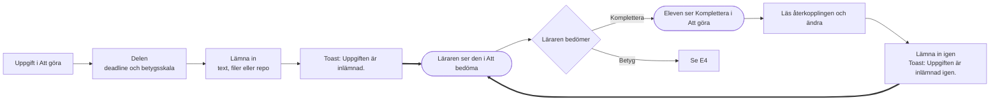

### E4 · Återkoppling och betyg

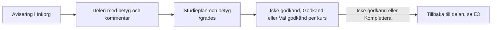

### L1 · Förbereda kursen

Läraren tilldelas kursen av admin (A2). Allt kopierat och allt nytt är utkast tills läraren publicerar.

### L2 · Köra veckan

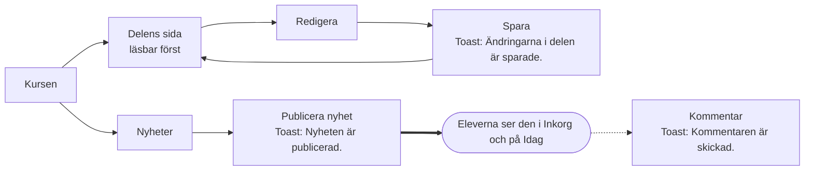

### L3 · Bedöma

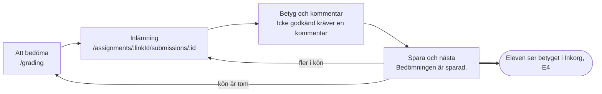

### M1 · Följa klassen

Mentorn läser och ändrar ingenting.

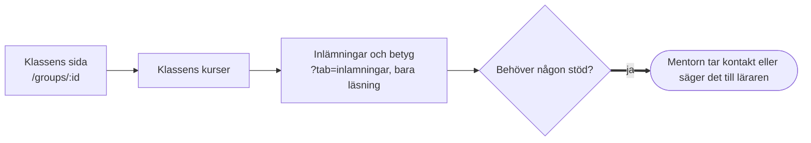

### A1 · Sätta upp klassen

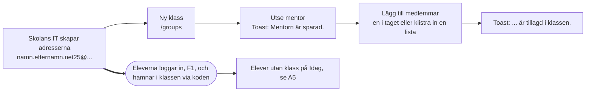

### A2 · Planera terminen

### A3 · Byta lärare

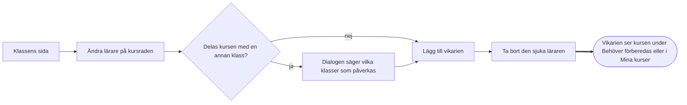

### A4 · Stänga terminen

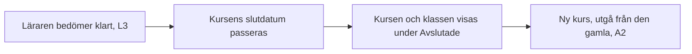

Ingen stänger terminen med en knapp. Avslutade kurser och klasser följer av datumen och flyttas till en hopfälld grupp _Avslutade_ i sidomenyn, i Alla grupper, på klassens sida, i kalenderns kursval och bland materialets flikar (_Visa avslutade_). Idag visar eleven bara pågående och kommande kurser, och läraren bara pågående kurser och avslutade med inlämningar kvar att bedöma. Avslutade kurser och klasser räknas inte som saknad lärare eller mentor i _Att ordna_. Inget tas bort och ingen förlorar åtkomst: länkar, material, betyg, studieplan, _Att bedöma_ och sökning når allt. Kurser utan datum räknas som pågående.

### A5 · Ordna det som saknas

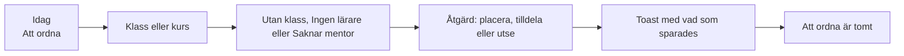

### Fel och behörighet

En sida som kräver en behörighet användaren saknar öppnas inte. Användaren hamnar på Idag med toasten "Du har inte behörighet till den sidan." Fel från servern visas alltid på svenska: backends korta engelska meddelanden översätts i klienten (`client/src/lib/serverMessages.ts`), och okända fel får en allmän text efter statuskoden.
